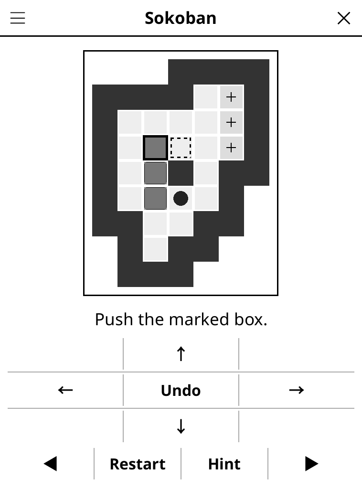

# sokoban.koplugin

A Sokoban plugin for [KOReader](https://github.com/koreader/koreader): push
every box onto a target.

## Screenshot

## Rules

Push every box onto a marked target square. Boxes can only be pushed (not
pulled). You cannot push two boxes at once or push a box into a wall. Plan
ahead — a box pushed into a corner may never move again.

## Features

- **372 original levels** in four difficulties, graded by the fewest
  pushes each one can be solved in: *Beginner* up to 12 pushes (100 levels),
  *Intermediate* 13–22 (100), *Advanced* 23–32 (100), *Expert* 33 or more
  (72, up to 57). Each band is ordered from its easiest level to its
  hardest.
- **Progress** — "New game" opens the next level you haven't solved; the
  *Level* menu lists every level of the difficulty with its box count and
  fewest pushes (✓ on solved ones), and the *Difficulty* menu shows how many
  you've solved.
- **Daily Challenge** — the same level for everyone today.
- **Hint** — two taps: the first marks the box to push next and outlines the
  square it goes to, the second walks there and pushes it. From the start a
  hint follows the stored optimal solution; once you have left it, a bounded
  search finds a way on from where you are (or says a box is stuck).
- **Show solution** — gives up the level and steps through an optimal
  solution, forwards and back.
- **Unlimited undo**, Restart, box/move/push counters and auto-save
  (position and moves are kept when you close the game).

## Controls

| Action | How |
|--------|-----|
| Move the player | Tap a square (one step towards it) or use the arrows |
| Undo last step | **Undo** (centre of the arrows) |
| Restart / Hint | Buttons under the arrows |
| Previous / next level | **◀** / **▶** |
| New game, Daily Challenge, difficulty, level, solution, rules | Title-bar menu |

## Why e-ink friendly?

Sokoban is turn-based with one screen update per move. The top-down grid is
drawn with flat greys and a cross on each target, readable on any e-ink
screen.

## Levels

The levels are original, not taken from any published collection: they are
generated offline by `tools/` (not shipped), after Taylor & Parberry's
method ("Procedural generation of Sokoban levels", 2011). A random room is
carved, goals are placed, and a breadth-first search runs *backwards* from
the solved position (pulling boxes instead of pushing them) over the whole
state space; the deepest state becomes the start, so every level is solvable
by construction and its push count is the exact optimum. A hill climb on the
goals and walls looks for deeper puzzles.

Each level is then re-verified independently by `tools/merge_levels.lua`:
its stored solution must replay legally to a win in that many pushes, and an
A* search (`solver.lua`, admissible heuristic) must find no shorter one.
Mirror images and rotations of a level count as duplicates. The game ships
the result as `levels_data.lua`, one line per level (optimal pushes, LURD
solution, map). Rebuild with `tools/build_levels.sh`; `tools/hint_cost.lua`
measures how hard the on-device hint search works.

## License

GPL-3.0
